<div align="center">

# 🐍 Питоника

**Локальный тренажёр Python с ИИ-наставником — от `print` до циклов, по 10 минут в день.**

Уроки, задачи с настоящей автопроверкой кода, серия дней, XP, карта знаний и интервальное повторение.
Полностью на вашем компьютере: без регистрации, облака и подписок.

[](https://github.com/EdKim155/pitonika/actions/workflows/ci.yml)
[](LICENSE)
[](https://www.python.org/)
[](https://fastapi.tiangolo.com/)
[](https://react.dev/)
[](#безопасность-и-приватность)

[Возможности](#-возможности) · [Скриншоты](#-скриншоты) · [Быстрый старт](#-быстрый-старт) · [ИИ-наставник](#-ии-наставник) · [Архитектура](#-архитектура) · [Тесты](#-тесты) · [Дорожная карта](#-дорожная-карта)

</div>

---

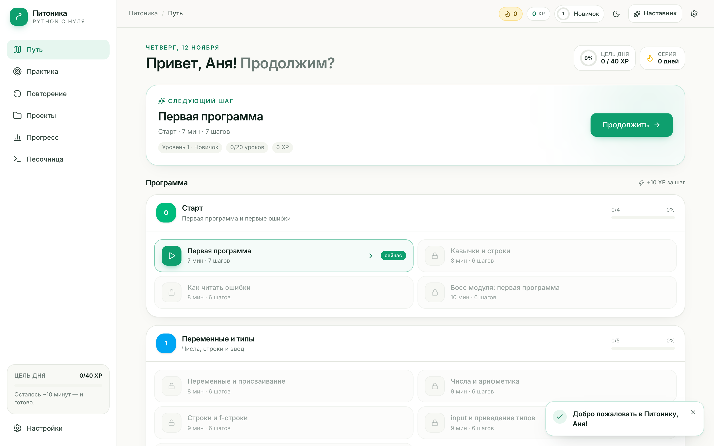

## ✨ О проекте

Питоника — это приложение для macOS, которое запускается одной командой и открывается в браузере на `http://127.0.0.1:8420`. Внутри — короткие уроки, интерактивные задания и наставник, который объясняет ошибки простыми словами, но не выдаёт готовый ответ.

Проект вырос из простого наблюдения: готового «Duolingo для Python» с русским интерфейсом, автопроверкой кода, прогрессом и локальным ИИ не существует. [Exercism](https://github.com/exercism/website) не поддерживает локальный запуск, [Runestone](https://github.com/RunestoneInteractive/rs) — англоязычный учебник, [Hedy](https://github.com/hedyorg/hedy) рассчитан на детей, а AI-тьюторы вроде `llamatutor` умеют только чат. Поэтому здесь собраны лучшие идеи этих проектов — лестница подсказок, типы интерактивов, модель прогресса — и написано собственное приложение с нуля.

## 🚀 Возможности

| | |
|---|---|
| **20 уроков, 125 шагов, 40 задач**<br>От первой программы до циклов, цифр числа и «боссов» модулей. | **Настоящая автопроверка**<br>Код запускается в отдельном процессе: таймаут, лимит вывода, stdin-фикстуры, скрытые тесты. |
| **8 типов заданий**<br>Теория, вопрос, «что выведет», пропуски, сборка из строк, поиск ошибки, код, свободный ответ. | **ИИ-наставник**<br>Подсказки в три шага, разбор traceback, код-ревью и сократический чат. Ollama, LM Studio или облачный API. |
| **Прогресс, который видно**<br>XP и уровни, серия дней с заморозками, тепловая карта, точность, мастерство тем. | **Интервальное повторение**<br>Слабые темы возвращаются через 1/3/7/16/35/75 дней — знания не выветриваются. |
| **Практика по слабым местам**<br>Подборка задач строится по концептам с наименьшим мастерством. | **Песочница и проекты**<br>Свободный редактор со сниппетами и шесть мини-проектов с чек-листами. |
| **Тёмная тема и мобильная вёрстка**<br>Клавиатурная навигация, аккуратная типографика, шрифты без CDN. | **Локальные данные**<br>SQLite в `data/`, ключи с правами `600`, никакой телеметрии. |

## 📸 Скриншоты

| Путь | Урок |
|:---:|:---:|
| [](docs/screenshots/path.png) | [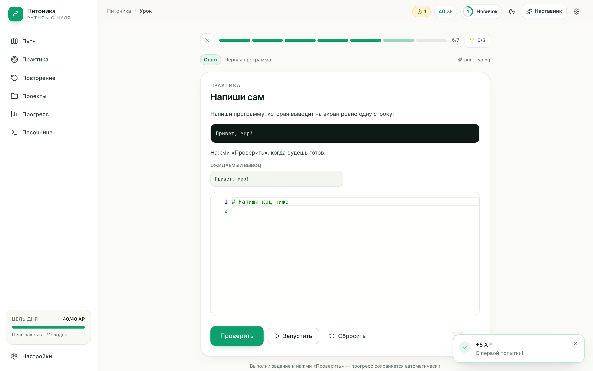](docs/screenshots/lesson.png) |
| **Результат проверки** | **Завершение урока** |
| [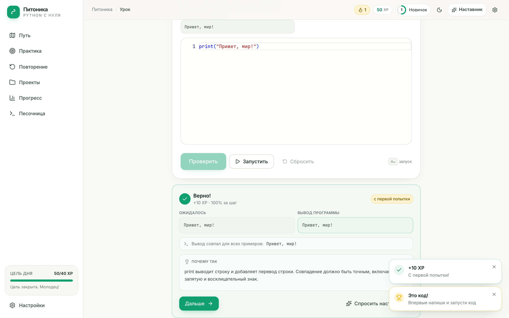](docs/screenshots/result.png) | [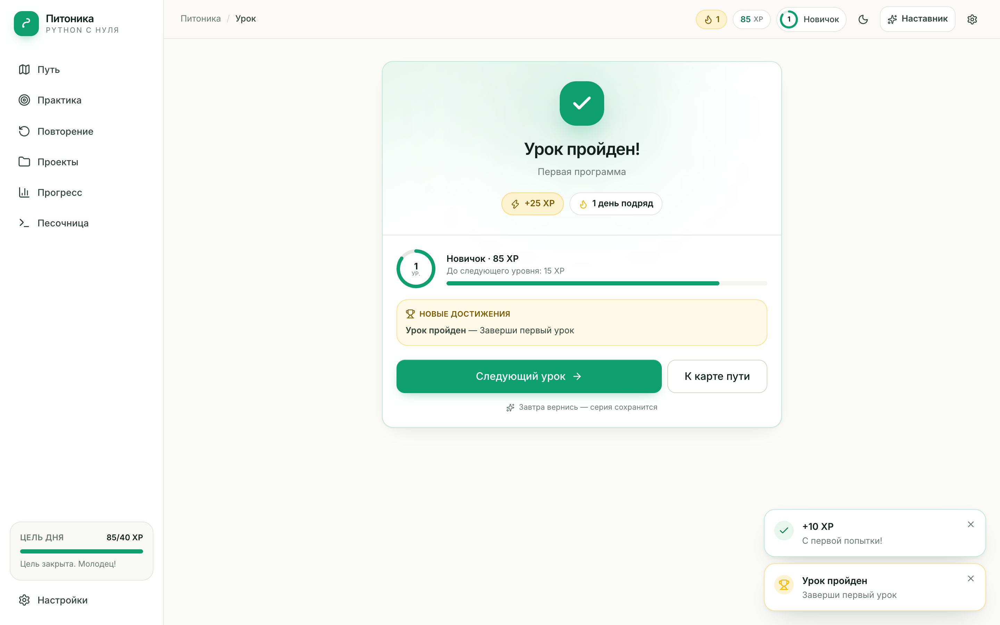](docs/screenshots/complete.png) |
| **Прогресс** | **ИИ-наставник** |
| [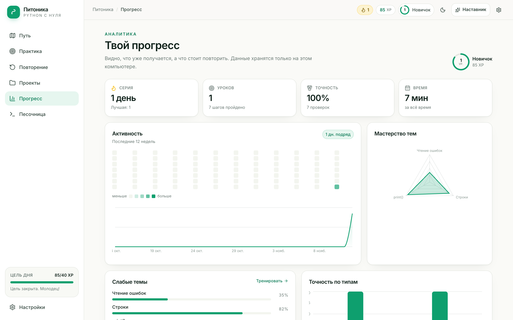](docs/screenshots/progress.png) | [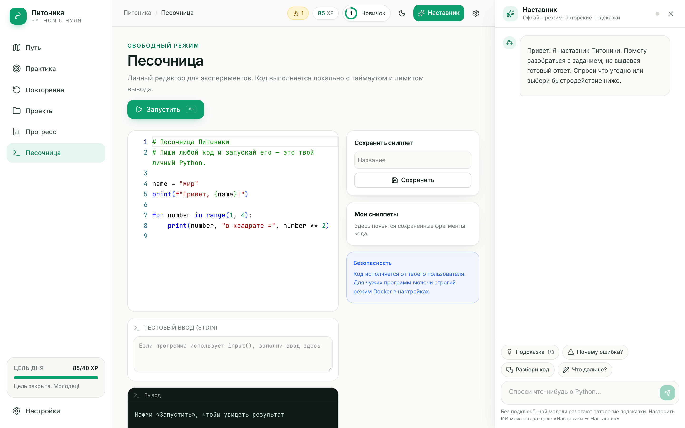](docs/screenshots/ai.png) |
| **Практика** | **Повторение** |
| [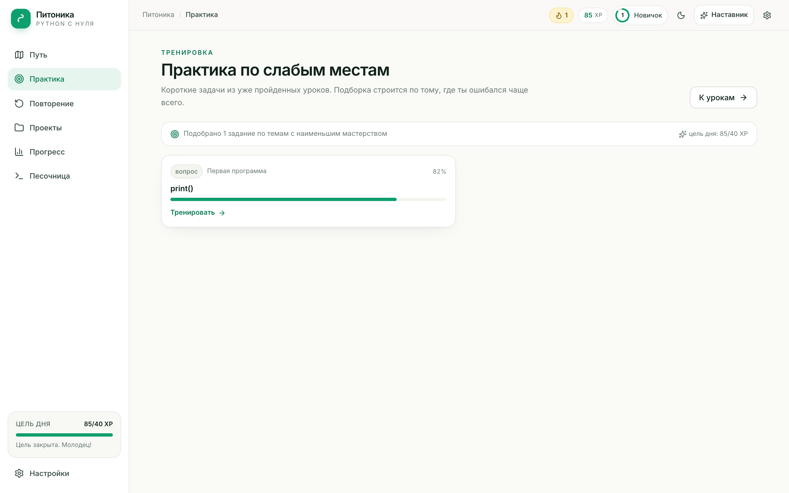](docs/screenshots/practice.png) | [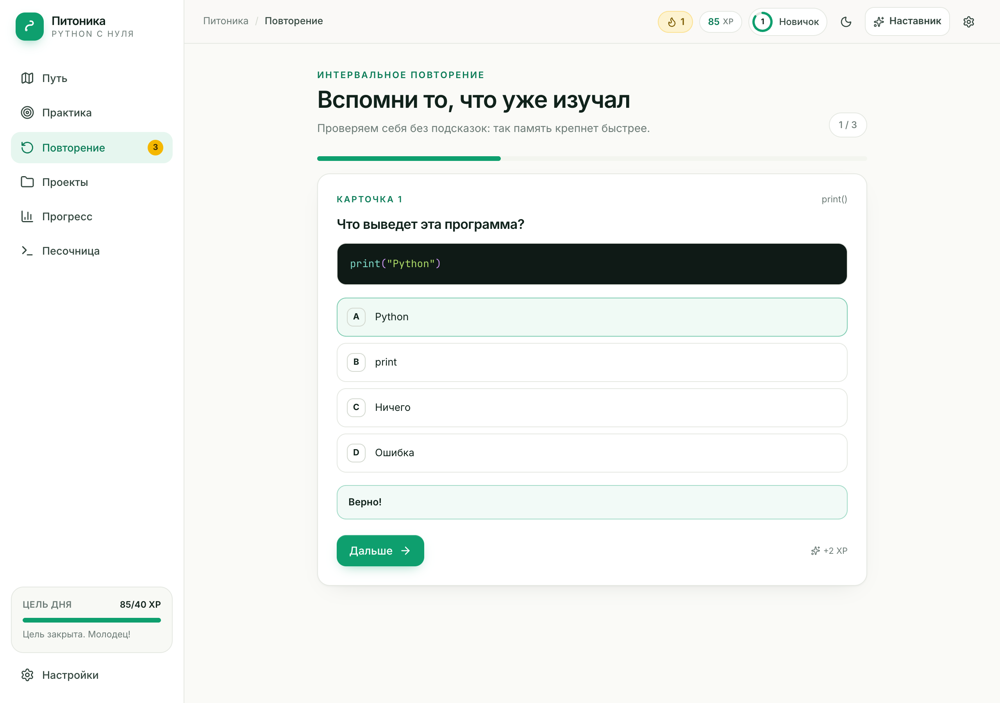](docs/screenshots/review.png) |
| **Проекты** | **Настройки** |
| [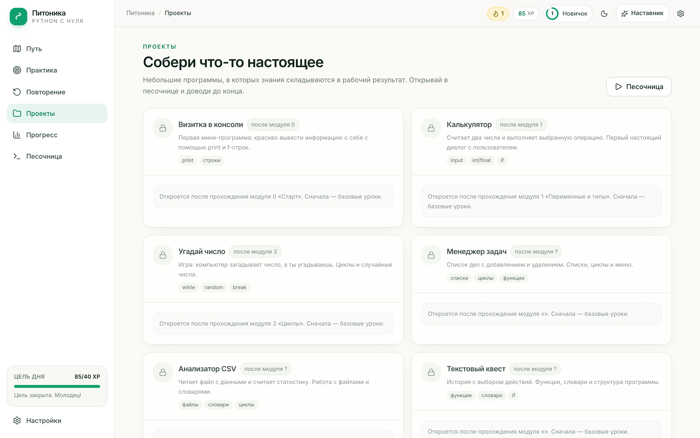](docs/screenshots/projects.png) | [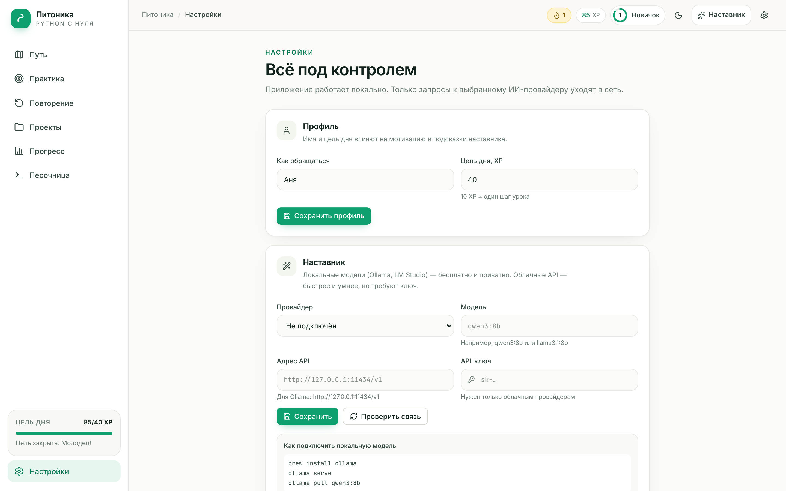](docs/screenshots/settings.png) |

Ещё: [онбординг](docs/screenshots/onboarding.png) · [песочница](docs/screenshots/playground.png) · [мобильная версия](docs/screenshots/mobile.png)

## ⚡ Быстрый старт

**Требования:** macOS, Python 3.12, Node.js 20+ и `pnpm`. Интернет нужен только для установки зависимостей и работы облачного ИИ.

```bash
cd pitonika
./start.command        # двойной клик в Finder тоже работает
```

`start.command` сам создаст `.venv`, установит зависимости, соберёт интерфейс и откроет браузер. Если порт `8420` занят, приложение возьмёт следующий свободный.

<details>
<summary>Или вручную через make</summary>

```bash
make setup    # venv + pip + pnpm install + сборка SPA
make run      # http://127.0.0.1:8420
make dev      # режим разработки: FastAPI --reload + Vite
```
</details>

### Как проходит первый день

1. Онбординг: имя, цель, 10 минут в день, мини-диагностика.
2. Урок 0.1: `print`, первая программа, мгновенная проверка.
3. Начисляются XP, закрывается цель дня, растёт серия.
4. На следующий день приложение напоминает о себе карточками повторения.

## 🤖 ИИ-наставник

Наставник умеет: давать подсказку нужного уровня, объяснять ошибку по traceback, разбирать решение после успеха, отвечать на вопросы по текущему шагу и строить план обучения. Всё — на русском и без готовых ответов.

### Локально через Ollama

```bash
brew install ollama
ollama serve
ollama pull qwen3:8b
```

Затем в приложении: **Настройки → Наставник** → провайдер `Ollama`, адрес `http://127.0.0.1:11434/v1`, модель `qwen3:8b` → **Проверить связь** → **Сохранить**.

### Облачный API

| Провайдер | Адрес | Ключ |
|---|---|---|
| OpenAI | `https://api.openai.com/v1` | нужен |
| DeepSeek | `https://api.deepseek.com/v1` | нужен |
| OpenRouter | `https://openrouter.ai/api/v1` | нужен |
| Anthropic | `https://api.anthropic.com` | нужен |
| LM Studio | `http://127.0.0.1:1234/v1` | не нужен |
| Любой OpenAI-совместимый | свой | по необходимости |

Ключ хранится локально в `data/secrets.json` с правами `600` и никогда не возвращается в API — только маска вида `…abcd`.

### Без модели

Приложение остаётся полностью рабочим: у каждого шага есть три авторские подсказки, а проверка кода, прогресс и повторение от ИИ не зависят. ИИ улучшает опыт, но не является зависимостью.

## 🧠 Как это работает

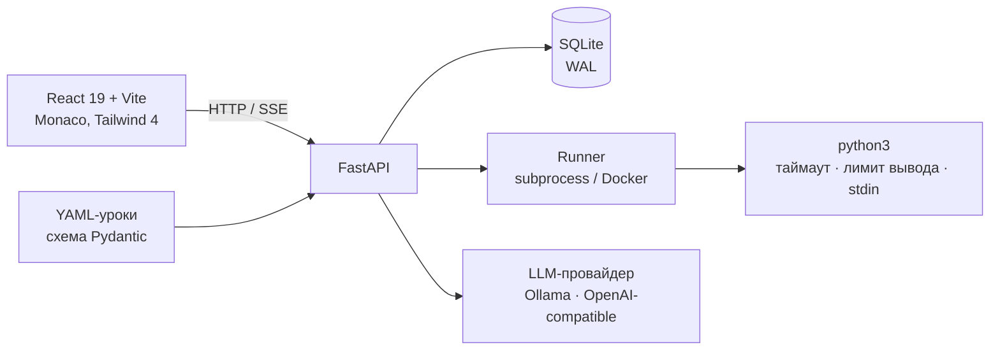

```
pitonika/
├── start.command              # запуск двойным кликом
├── Makefile                   # setup / dev / test / validate / e2e
├── server/                    # FastAPI + SQLAlchemy + SQLite
│   ├── app/api/               # bootstrap, content, grading, run, review, ai, settings
│   ├── app/content/           # схема и загрузчик YAML
│   ├── app/runner/            # песочница и harness для скрытых тестов
│   ├── app/services/          # проверка, XP, streak, mastery, SRS
│   ├── app/ai/                # провайдеры, промпты, гардрейлы
│   ├── content/               # 4 модуля, 20 уроков, 26 концептов
│   └── tests/                 # 27 pytest-тестов
├── web/                       # React 19 + Vite + Tailwind 4 + Monaco
│   ├── src/routes/            # путь, урок, практика, повторение, прогресс…
│   ├── src/components/        # шаги урока, наставник, графики, UI
│   └── e2e/                   # 3 Playwright-сценария
├── scripts/                   # serve, dev, валидация контента
└── data/                      # app.db, runs/, secrets.json — не в git
```

**Поток проверки:** браузер → `POST /api/grade` → временная папка → `python3` с таймаутом → сравнение stdout или скрытые unit-тесты → результат, XP, мастерство, повторение.

## 📚 Учебная программа

| Модуль | Уроков | О чём |
|:---|:---:|---|
| **0. Старт** | 4 | `print`, кавычки, чтение ошибок, первая программа |
| **1. Переменные и типы** | 5 | присваивание, числа, f-строки, `input`, приведение типов |
| **2. Ветвления** | 5 | `if/elif/else`, сравнения, логика, вложенные условия |
| **3. Циклы** | 6 | `while`, `for`, `range`, `break/continue`, накопление, цифры числа |

Каждый модуль завершается «боссом» — набором задач на всё пройденное. Дальше по плану: строки, списки, словари, функции, файлы, ООП, питоничный код, тесты.

### Добавить свой урок

Урок — это YAML-файл в `server/content/lessons/`. Схема описана в [`server/app/content/schema.py`](server/app/content/schema.py), пример — [`m0.l1.yaml`](server/content/lessons/m0.l1.yaml).

```yaml
id: m1.l2
module: m1
title: "Числа и арифметика"
order: 2
minutes: 8
concepts: [int, operators]
steps:
  - id: m1.l2.s1
    type: code
    mode: io
    prompt: "Считай два числа и выведи сумму."
    fixtures:
      - {stdin: "2\n3\n", stdout: "5\n"}
    hints: ["Намёк", "Направление", "Структура"]
    solution: "a = int(input())\nb = int(input())\nprint(a + b)"
```

После добавления:

```bash
./.venv/bin/python scripts/check_lessons.py m1   # схема + прогон эталонов модуля
./.venv/bin/python scripts/validate_content.py   # весь контент
```

## ✅ Тесты

| Что | Команда | Статус |
|---|---|---|
| Бэкенд и контент | `make test` | **27 passed** |
| Все эталонные решения | `make validate` | **40 задач / 20 уроков** |
| E2E в браузере | `make e2e` | **3 passed** |

- `pytest` проверяет раннер (таймауты, лимит вывода, stdin), грейдинг, XP/streak/SRS, API и схему контента.
- Каждое эталонное решение прогоняется против своих фикстур и тестов на Python 3.12 и 3.14.
- Playwright проходит онбординг, урок до квиза, навигацию по разделам и офлайн-подсказки.

## 🔒 Безопасность и приватность

- Сервер слушает только `127.0.0.1`.
- Код ученика запускается от вашего пользователя: обычный режим защищает от случайных ошибок (таймаут, лимит вывода, временная папка), но не изолирует файловую систему и сеть.
- Для настоящей изоляции включите **строгий режим Docker** в настройках: контейнер без сети, с лимитами памяти и процессов. Режим проверен вживую, включая таймауты.
- Ключи API хранятся в `data/secrets.json` (`chmod 600`) и не попадают в логи.
- Никакой телеметрии и внешних шрифтов: приложение работает офлайн, кроме запросов к выбранной LLM.

## 🗺 Дорожная карта

- [x] Ядро: путь, уроки, 8 типов заданий, автопроверка
- [x] Прогресс: XP, серия, мастерство, достижения, SRS
- [x] ИИ-наставник с офлайн-фолбэком
- [x] Песочница, проекты, настройки, тёмная тема
- [x] 20 уроков MVP и контент-валидация
- [ ] Модули 4–12: строки, списки, словари, функции, файлы, ООП
- [ ] Серверная проверка чек-поинтов проектов
- [ ] Генерация задач ИИ с автоматической валидацией тестами
- [ ] Английская локализация и PWA

## 📄 Лицензия

Код распространяется по [MIT](LICENSE). Учебный контент написан специально для проекта. Зависимости — MIT/BSD/Apache-2.0: FastAPI, SQLAlchemy, React, Vite, Tailwind CSS, Monaco, Recharts, lucide.

---

<div align="center">
Сделано для тех, кто учится с нуля — и хочет видеть, как растёт.
</div>
